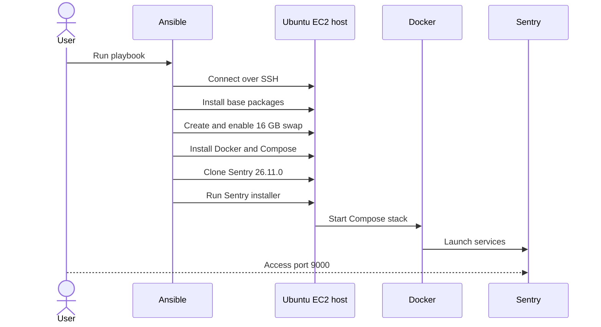

# Ansible

This directory contains the Ansible configuration for provisioning the host
created in `../terraform/` and deploying Sentry.

The playbook installs Docker and Compose, creates a 16 GB swap file, clones
Sentry 26.11.0, runs the installer, and starts the Docker Compose stack.

## Deployment flow



## Prerequisites

- Ansible
- The Terraform EC2 instance running
- SSH access using `~/.ssh/id_ed25519`
- Port 22 reachable from the current machine

## Setup

```bash
cd ansible
IP="$(cd ../terraform && terraform output -raw public_ip)"
sed "s/<PUBLIC_IP>/$IP/" inventory.ini.example > inventory.ini
```

Verify SSH and Ansible connectivity:

```bash
ssh -i ~/.ssh/id_ed25519 -o StrictHostKeyChecking=accept-new "ubuntu@$IP" true
ansible -i inventory.ini sentry -m ping
```

## Run

```bash
ansible-playbook -i inventory.ini playbook.yaml
```

Sentry should be available on the EC2 public address at port `9000`.
