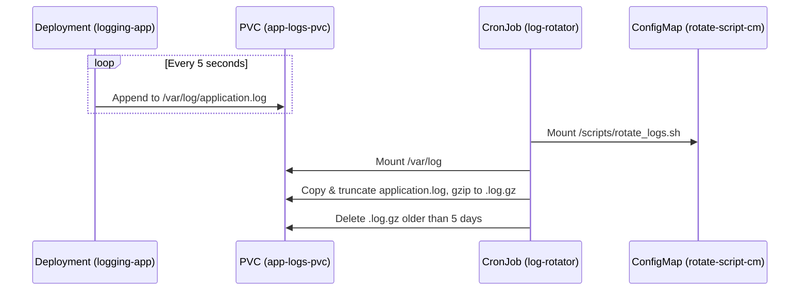

# Kubernetes Log Rotation

This setup runs a container that writes logs to `/var/log/application.log` on a shared `PersistentVolumeClaim`, and a `CronJob` that periodically rotates, compresses, and cleans up old log files.

## How It Works

* **`pvc.yaml`**: Creates a `1Gi` `ReadWriteOnce` `PersistentVolumeClaim` (`app-logs-pvc`) mounted at `/var/log` by both the app and the rotation job.
* **`deployment.yaml`**: Runs a `busybox` pod (`logging-app`) that appends a line to `/var/log/application.log` every 5 seconds.
* **`rotate_logs.sh` & `configmap.yaml`**: Stores the rotation script in a `ConfigMap` (`rotate-script-cm`) and mounts it at `/scripts/rotate_logs.sh`.
* **`cronjob.yaml`**: Runs `rotate_logs.sh` every 5 minutes (`*/5 * * * *`) with `concurrencyPolicy: Forbid` so jobs never overlap.
  * If `/var/log/application.log` does not exist yet, the script logs a message and exits `0`.
  * If the log file has content, it copies it to a timestamped `.log` file, truncates `application.log` in place so the app keeps writing without interruption, and compresses the copy with `gzip`.
  * It removes any `application-*.log.gz` files older than 5 days (`RETENTION_DAYS=5`).

### Architecture Diagram



## Files

```text
kubernetes/
├── pvc.yaml
├── deployment.yaml
├── configmap.yaml
├── cronjob.yaml
├── rotate_logs.sh
└── README.md
```

## Prerequisites

* A local Kubernetes cluster (`minikube` or `k3s`)
* `kubectl` configured for the cluster

## Setup & Run

1. **Apply the manifests:**
   ```bash
   kubectl apply -f kubernetes/pvc.yaml \
     -f kubernetes/deployment.yaml \
     -f kubernetes/configmap.yaml \
     -f kubernetes/cronjob.yaml
   ```

   *(If you edit `rotate_logs.sh`, update `configmap.yaml` before applying:)*
   ```bash
   kubectl create configmap rotate-script-cm \
     --from-file=rotate_logs.sh=kubernetes/rotate_logs.sh \
     --dry-run=client -o yaml > kubernetes/configmap.yaml
   ```

2. **Verify the app is writing logs:**
   ```bash
   kubectl rollout status deployment/logging-app
   kubectl exec deploy/logging-app -- tail -n 5 /var/log/application.log
   ```

## Testing

1. **Run a rotation job manually:**
   ```bash
   kubectl create job --from=cronjob/log-rotator test-rotate
   kubectl wait --for=condition=complete job/test-rotate --timeout=30s
   kubectl logs job/test-rotate
   ```

2. **Check the `.log.gz` archive in `/var/log`:**
   ```bash
   kubectl exec deploy/logging-app -- ls -lh /var/log
   ```

3. **Test 5-day retention:**
   Create an archive with a timestamp older than 5 days and run the job again:
   ```bash
   kubectl exec deploy/logging-app -- touch -t 202601010000 /var/log/application-20200101T000000Z.log.gz
   kubectl create job --from=cronjob/log-rotator test-retention
   kubectl wait --for=condition=complete job/test-retention --timeout=30s
   kubectl logs job/test-retention
   kubectl exec deploy/logging-app -- ls -lh /var/log
   ```

4. **Clean up:**
   ```bash
   kubectl delete job test-rotate test-retention
   kubectl delete -f kubernetes/cronjob.yaml -f kubernetes/configmap.yaml -f kubernetes/deployment.yaml -f kubernetes/pvc.yaml
   ```
