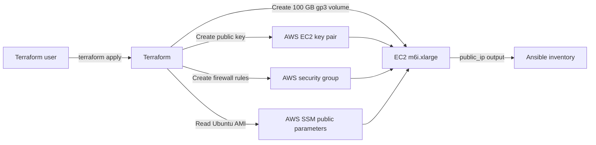

# Terraform

This directory contains the Terraform configuration for the Sentry lab. It
provisions an Ubuntu EC2 instance, an SSH key pair, a security group, and a
100 GB gp3 root volume in `eu-north-1`.

## Prerequisites

- Terraform
- AWS credentials with permission to manage EC2, key pairs, security groups,
  and SSM parameters
- An existing default VPC/subnet in `eu-north-1`
- A public SSH key at `~/.ssh/id_ed25519.pub`

The configuration uses the paid `m6i.xlarge` instance type and may incur AWS
charges.

## Architecture



## Setup

```bash
cd terraform
cp terraform.tfvars.example terraform.tfvars
```

Replace the example CIDRs in `terraform.tfvars` with the public IPv4 addresses
that should be allowed to use SSH and Sentry. Use `/32` for one address.

## Commands

```bash
terraform init
terraform fmt -check -recursive
terraform validate
terraform plan
terraform apply
terraform output -raw public_ip
terraform destroy
```

After applying, pass the public IP to the inventory example in `../ansible/`.
